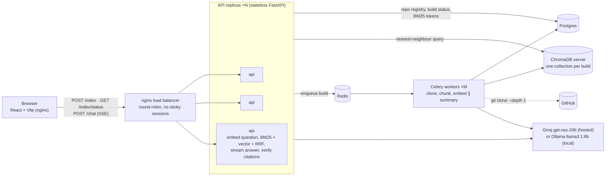

# Codebase-QA-Agent

Paste a public GitHub URL, and the app clones the repo, splits it into chunks, indexes them in ChromaDB and writes a summary card. You can then ask questions in a chat and get a streamed answer with `[file:lines]` citations. After each answer, the server checks every citation against the code it actually retrieved and marks it ✓ or ⚠ in the UI. Retrieval is hybrid (embeddings + BM25, merged with Reciprocal Rank Fusion). Everything was measured on a 24-question golden dataset, and the numbers below are real, including the ones that went against my expectations.

**Stack:** Python 3.11 · FastAPI · ChromaDB · `rank_bm25` · Postgres (SQLAlchemy) · Celery + Redis · nginx · React + Vite · Docker / docker compose · Groq (`openai/gpt-oss-20b`) or Ollama (`llama3.1:8b`) through the `openai` SDK.

## Architecture



`docker compose up` runs the whole picture. With `DATABASE_URL`, `REDIS_URL` and `CHROMA_HOST` unset, the same image runs as **one self-contained process** (SQLite, embedded Chroma, indexing in a background thread). That's how the Render free-tier deploy runs, from the same code path.

## Request flow

**`POST /index`** only records a build and returns at once. Indexing takes ~1 min locally and ~10 min on Render's free CPU, too long to hold an HTTP request open.

- The URL must be `https://github.com/<owner>/<repo>`; anything else is a 400, because it goes straight to `git clone` (`file://`, `ssh://` and internal hosts would be a server-side request forgery hole).
- Already indexed: `200` with the repo (`cached: true`). Otherwise `202` with `status: "queued"` and a `build_id`. Concurrent requests for the same repo, on any replica, get the **same** build (a unique key plus a compare-and-set in Postgres).
- The client polls `GET /index/status?repo_url=…` until `status` is `indexed` or `failed`.

The build (`tasks.run_build`, on a Celery worker) then runs:

1. `clone`: shallow clone into a temp dir, after a size check (limit 200 MB, 5-minute timeout).
2. `chunk`: walk supported files and split them into line-window chunks (60 lines, no overlap). Lockfiles and `.json` files over 10 KB (data dumps, not configs) are skipped. Each chunk has `content`, `file`, `lines`, `language` and `node_type`.
3. In parallel:
   - `embed`: upsert the chunks into a per-repo ChromaDB collection (all-MiniLM-L6-v2 via ONNX, batches of 8), then build the BM25 index.
   - `summary`: one LLM call using the README, file listing and entry points. It doesn't need embeddings, so it overlaps with the slowest step.
4. Publish: in one transaction, point the repo at the new collection, store stats, summary, `timings_ms` and the BM25 tokens, and mark it `ready`. Then delete the repo's other collections (the previous version, and any left half-built by a crashed attempt).

**`POST /chat`** (Server-Sent Events)

1. Look up the repo's serving collection in Postgres (~1 ms) and get a query-only indexer from a per-replica LRU cache keyed by collection name. A rebuild publishes a new name, so the cache never needs invalidating.
2. Retrieve the top 8 chunks. Hybrid = top 24 from the vector search + top 24 from BM25, merged with RRF (k = 60), top 8 kept.
3. Send a `sources` event, then build the prompt (system prompt + last 6 history messages + the 8 chunks + the question).
4. Stream the model's tokens as `text` events. If the model fails (usually its rate limit), send a `warning` event and end the stream cleanly.
5. Once the answer is complete, `verify_citations` parses every `[file:lines]` and sends a `confidence` event. It also sends per-citation results.
6. Send a `timings` event (retrieval ms, time to first token, total) and `[DONE]`.

## Design decisions and trade-offs

| Decision | Why | Cost / what I'd say about it honestly |
|---|---|---|
| **Stateless API replicas** | Everything a replica needs is shared: the repo registry, build status and BM25 tokens in Postgres, vectors in a Chroma server, builds in Celery. A chat is one self-contained request (the client sends the history), so any replica can serve any request and the load balancer needs no sticky sessions. | Each replica still loads the embedding model (~250 MiB) to embed questions. A separate embedding service would make replicas lighter but add a network hop to every query; not worth it at this size. |
| **Indexing on a job queue (Celery + Redis)** | The 370 MiB embedding spike never lands on an API replica, indexing capacity scales by adding workers, and a build survives a dead worker: acks are late, so Redis redelivers the job (tested by killing the worker mid-build). | Redelivery waits for the visibility timeout (900 s by default, set longer than the slowest build so a running job isn't duplicated). Duplicates are harmless anyway: see the next row. |
| **Compare-and-set build lifecycle** | Each build has a `build_id`, and every write checks it. A stale or duplicate job can't publish over a newer build, and a duplicate that fails late can't flip a ready repo to "failed". | More states to reason about. They're covered by unit tests in `tests/test_build_lifecycle.py`. |
| **Blue/green collections** | Each build writes a fresh collection and the switch is one DB transaction, so a forced rebuild never takes chat down and readers never see a half-built index. | Disk briefly holds two copies of a repo during a rebuild. |
| **One code path for one process or many** | Without the service URLs, the same image uses SQLite, embedded Chroma and an in-process thread for builds, so the Render free tier still works. | Single-process mode has the same API (`202` + polling) but no crash recovery: a restart marks in-progress builds failed. |
| **Parallel summary** | The summary overlaps with embedding, so indexing takes about max(embed, summary), not the sum. | The summary (about 0.8 s) is completely hidden behind embedding, so the gain is small. The real bottleneck is embedding. |
| **Embedding model baked into the image, loaded at startup** | The first `/index` doesn't pay a download, and `/chat` doesn't pay a model load. | Image is bigger. |
| **Hybrid retrieval (BM25 + vector, RRF)** | The embedder only reads the first 256 tokens of each chunk (about half of the indexed text). BM25 reads the whole chunk. RRF merges by rank, so BM25 scores and cosine distances never need to be on the same scale. | BM25 is about 3.5 ms. On my eval, BM25 *alone* ranked better than hybrid (see Evaluation). I kept hybrid because the LLM reads all 8 chunks, so Recall@8 is the number that limits the answer. |
| **No cross-encoder reranker** | Doesn't fit the Render free tier's 512 MB, and the retrieval gap is already large enough that cheaper fixes should come first. | Listed under next steps. `RERANKER_ENABLED` in `.env.example` is a leftover; there is no reranker code. |
| **Function-aware Python chunker, built but off** | I measured it before shipping it. It put the right file at rank 1 more often but did not improve Recall@8 and made indexing `psf/requests` 53% slower. | It's behind `FUNCTION_AWARE_CHUNKS = False`, with its own tests and an eval flag (`--chunker ast`). |
| **`UPSERT_BATCH_SIZE = 8`** | Indexing `psf/requests` under a hard 512 MB limit was OOM-killed at a peak of 721 MiB with batch 100. Batch 8 peaks at about 353 MiB. | Embedding is about 35–45% slower. I chose staying on the free tier over speed. |
| **Verifiable citations** | The prompt asks for `[file:lines]`, but a prompt is a request, not a guarantee. `verify_citations` is a pure function (103 unit tests across the repo pass, 38 of them for citations). A citation is valid only if the file is indexed **and** the cited lines overlap a chunk retrieved for this answer. | It proves the citation points at code the model was given. It does **not** prove the claim is supported by that code. |
| **Provider abstraction** | `llm_client.py` is the only file that imports the `openai` SDK or names a provider. Ollama and Groq both speak the OpenAI API, so switching is an env var plus one function. | That's how the Groq model retirement was handled with a one-line change. |
| **No LangChain / LlamaIndex** | The pipeline is about a dozen small functions. Owning them made it possible to time every stage, swap retrieval methods behind one `method=` argument, and write the eval harness against the same code the server runs. | I give up the ready-made integrations. |
| **Model change** | Groq retired its Llama models, so the hosted app uses `openai/gpt-oss-20b` (`reasoning_effort="low"`). Local Ollama still runs `llama3.1:8b`. | **All numbers in this README were measured with gpt-oss-20b**, not Llama. |

## Evaluation

### Method

- **Golden dataset:** 24 questions over 2 repos (12 each): `psf/requests` pinned at `3c7baaa` and this repo pinned at `918a854`. Per repo there are 3 questions of each kind: *definition* ("where is X defined"), *flow* ("how does X work"), *config* and *identifier*. Every question lists the file(s) that contain the answer, and `python -m eval.golden_dataset --verify` checks the labels against the pinned checkouts.
- **Retrieval eval** (`python -m eval.eval_retrieval --method embedding|bm25|hybrid`): index the pinned repos and ask each question. It is deterministic for BM25 and on the host. In Docker, embedding runs varied by about one question's worth (one of four runs moved a single rank).
- **Answer eval** (`python -m eval.eval_answers`): run all 24 questions through the real `/chat` path in Docker and score the saved answers with the same `verify_citations` the server uses (`--rescore` re-scores a saved run without new LLM calls).
- **Caveat:** I wrote the questions knowing the code, so they reuse its vocabulary ("max redirects"). That favours keyword search. n = 24 means one question moves a metric by about 0.04, and a per-kind row (n = 6) by about 0.17. Read the per-kind rows as direction, not precision.

### What the metrics mean

| Metric | In plain English |
|---|---|
| **Recall@k** | Of the files that contain the answer, what share shows up in the top k retrieved chunks? k counts *chunks*, since the model is handed the top 8. Recall@8 is the ceiling on what the answer can be based on. |
| **MRR** (mean reciprocal rank) | 1 / the rank of the first chunk from a correct file, averaged over questions (0 if none is in the top 8). 1.0 means the right file is always first, 0.5 means it's typically second. It measures *ordering*. |
| **Citation validity** | Of the `[file:lines]` citations in an answer, the share where the file is indexed and the lines overlap a chunk retrieved for that answer. |
| **TTFT** | Time to first token: how long the user waits before the first word appears (retrieval + prompt building + model latency, including the model's hidden reasoning). |
| **p50 / p95** | The median, and the value 95% of requests beat. p95 shows the slow tail. With 10–24 samples, p95 is basically the second-slowest request, so I quote p50 and treat p95 as rough. |

### Retrieval quality

| Method | Recall@1 | Recall@3 | Recall@5 | Recall@8 | MRR |
|---|---|---|---|---|---|
| Embedding-only (baseline) | 0.33 | 0.68 | 0.78 | 0.90 | 0.56 |
| Keyword (BM25) only | **0.56** | **0.83** | **0.89** | 0.95 | **0.79** |
| Hybrid (RRF, k=60) | 0.35 | 0.78 | 0.87 | **0.97** | 0.65 |
| Hybrid + Python function-aware chunks (not adopted) | 0.51 | 0.72 | 0.83 | 0.94–0.97 | 0.71–0.72 |
| **Hybrid, no chunk overlap: the current default for `/chat`** | 0.47 | 0.74 | 0.89 | **0.97** | 0.72 |

Setup: measured 2026-11-19 on the host with ChromaDB 0.5.23 and the same all-MiniLM-L6-v2 ONNX model as the container. The function-aware row was measured in Docker, where retrieval isn't fully deterministic, so it is shown as a range over 3 runs. The first four rows use 10 lines of chunk overlap.

**What I learned from it:**
- **The embedder misses most of each chunk.** all-MiniLM-L6-v2 reads at most 256 tokens. A 60-line chunk has a median of about 500–550 tokens, and 85–89% of chunks are over the limit, so the embeddings cover only about 46–51% of the indexed text. In every miss I checked, the answer sat below that cutoff.
- **My hypothesis was wrong.** I expected identifier questions to be the weak spot for embeddings, the usual argument for hybrid search. They were the *strongest* kind (R@1 0.83, R@8 1.00). The weak kinds were *definition* (MRR 0.32) and *flow* (R@1 0.08), where the answer is a few lines inside a long chunk.
- **Hybrid fixed the one total miss.** "Where are the exception classes for connect and read timeouts defined?" had no relevant chunk in the baseline's top 8. With hybrid, `exceptions.py` is in the top 8 (rank 8), and no question has nothing relevant in the top 8.
- **Hybrid is not best at ranking.** BM25 alone beats it on MRR (0.79 vs 0.65). RRF rewards chunks that both retrievers rank moderately well, and test files and `HISTORY.md` match every query, so they collect two votes. I did not tune the weights, because that would be tuning on my own test set.
- **Dropping chunk overlap cost no recall.** It was done for speed (13% fewer chunks on `psf/requests`), with the rule that it ships only if hybrid Recall@8 holds. It did (0.97 → 0.97), and MRR went 0.65 → 0.72. I read that as "no drop", not "an improvement": moving chunk boundaries changes which lines land in the embedder's 256-token window, and embedding-only results reshuffled with no net trend (2 questions gained, 2 lost, R@8 0.92 → 0.88). Rebuilding the same index can also move one near-tie question at R@8, so that is the noise floor.

### Answer quality (citations)

| Run | Citation validity | Notes |
|---|---|---|
| Baseline (prompt v1, embedding-only) | 100% (3/3) | Only 1 of 24 answers used the `[file:lines]` format at all, so mean confidence was 0.04. The other 23 named files in prose ("see `indexer.py` lines 51–110"), which can't be verified. A follow-up live run got 0/10 bracket citations with the same prompt. |
| Hybrid + prompt v2 (explicit format, example, no prose references) | not measured yet | The run hit Groq's daily token cap (200k tokens/day, about 100k for a full 24-question run). |

So the honest status: the **validator works** (64 tests pass), but the baseline **model did not follow the citation format**. Prompt v2 is the fix, and it is not yet measured.

Answer run: 24/24 answered, 0 errors, in Docker with Groq `openai/gpt-oss-20b` (`reasoning_effort="low"`), questions 35 s apart.

## Latency

Baseline measured 2026-11-18 on local Docker (Docker Desktop on a Mac, 8 CPUs / 4 GB for the VM), Groq `openai/gpt-oss-20b`. Index values are `this repo (61 chunks) / psf/requests (335 chunks)`, one run each. Chat values come from 10 questions (5 per repo), 8 chunks retrieved, timed server-side.

| Stage | Baseline |
|---|---|
| Index: clone | 1.4 s / 1.2 s |
| Index: chunk | 3 ms / 7 ms |
| Index: embed | 6.7 s / **43.5 s** |
| Index: summary (runs in parallel with embed) | 0.7 s / 0.8 s |
| Index: total | 8.1 s / 44.6 s |
| Chat: retrieval | p50 110 ms / p95 269 ms |
| Chat: TTFT | p50 774 ms / p95 907 ms |
| Chat: total | p50 1.45 s / p95 2.10 s |

**Why it looks like this:**
- **Embedding is about 97% of indexing time** (about 130 ms per chunk), and it's the only stage that grows with repo size. The summary is fully hidden behind it. See "Speeding up indexing" below for what changed.
- **Chat latency is mostly the model**, not retrieval. In the 24-question answer run, TTFT minus retrieval ranged from 0.40 to 1.17 s, with a median TTFT of 879 ms (p95 2.06 s, driven by two slow retrievals).
- **Hybrid adds nothing measurable.** In Docker, over 3 × 12 questions: vector top 8 p50 561 ms; BM25 top 24 p50 3.5 ms; hybrid top 8 p50 555 ms. Retrieval time is the time to embed the question. That was about 460 ms in the container that day, much slower than the 110 ms retrieval in the baseline. It was the same for all methods and I have not found the cause.
- **I traded indexing speed for memory:** `UPSERT_BATCH_SIZE` 100 → 8 took indexing `psf/requests` from an OOM kill (peak 721 MiB) to a peak of about 353 MiB, and embed time from about 44 s to about 60 s.

### Speeding up indexing

**Diagnosis.** A profile showed that the time is all in the ONNX model; ChromaDB's own work is under 1 s per repo. I first planned to stop padding every chunk to 256 tokens, but measuring token lengths killed that idea: 89% of `psf/requests` chunks are *over* 256 tokens (median 556), so padding wastes only about 5% of the compute. Every chunk costs the same fixed 256 tokens, so **embedding time is proportional to the number of chunks**, and the only lever is embedding fewer of them.

**Changes:** skip lockfiles and `.json` files over 10 KB, and set chunk overlap from 10 lines to 0.

| Repo (commit) | Chunks before → after | Embed time, median of 3 `/index` runs: before → after |
|---|---|---|
| `psf/requests` (`3c7baaa`) | 335 → 292 (−13%) | 52.4 s → 34.8 s |
| this repo (`636f497`) | 290 → 100 (−66%) | 51.8 s → 11.6 s |

Measured 2026-11-19 through `docker compose` (same Docker Desktop VM as the baseline, `UPSERT_BATCH_SIZE = 8`), with "before" being the previous commit's code in the same container. In this repo, 183 of the 290 chunks were the eval harness's own JSON result files.

**How to read it:** the chunk counts are exact. The times are noisy on a laptop: the "before" runs got slower each rep (44 → 52 → 62 s), so the measured drop overstates the real one. In the quietest interleaved run under a 512 MB limit, every configuration cost 126–140 ms per chunk, so the dependable estimate of the saving is the chunk reduction itself. Peak memory is unchanged (about 300–330 MiB under a 512 MB limit), because the batch size didn't change.

## Horizontal scaling (measured)

`deploy/scale_test.py` (stdlib only) runs each check against the compose stack through the load balancer. Measured 2026-11-23 on the same Docker Desktop VM (8 CPUs / 4 GB), with **another project's 11-container stack running on the same VM**, so absolute numbers are noisy. Retrieval load uses `/debug/retrieval` (retrieval without the LLM), because the hosted model's 8k tokens/minute limit would measure the provider, not this system.

| Check | Result |
|---|---|
| Round-robin | 30 `/health` calls → 10 / 10 / 10 across 3 replicas |
| Any replica serves any repo | a repo indexed by the worker: 30/30 retrievals OK, from all 3 replicas |
| Duplicate `/index` | 5 concurrent forced rebuilds via 3 replicas → **1 build**; chat stayed available throughout (`ready: true`) |
| Kill an API replica under load | 427 requests in 31 s, **2 failed** (502: the requests in flight on the killed replica); nginx sent the rest to the survivors |
| Kill the worker mid-build | job redelivered by Redis and the **same build** finished (292 chunks); its half-built collection was garbage-collected |

**Retrieval throughput** (hybrid top 8 over `sindresorhus/is-online`, closed loop with N clients sending back to back, 20 s per run, after the padding fix below):

| API replicas | Concurrency 1: req/s, p50 | Concurrency 8: req/s, p50, p95 |
|---|---|---|
| 1 | 12.5, 66 ms | 21.0, 308 ms, 872 ms |
| 2 | 14.0, 66 ms | 28.2, 260 ms, 459 ms |
| 3 | 10.7, 67 ms | 27.0, 279 ms, 493 ms |

- **1 → 2 replicas gave +34% throughput and halved p95. 2 → 3 gave nothing**, because all replicas share one machine's 8 cores (and another stack was using some of them). Retrieval is CPU-bound (embedding the question), so more replicas on one box only help until the cores are busy. The real gain comes from spreading replicas across machines, which this design allows because nothing is pinned to a host.
- **Biggest single win: stop padding the question.** Chroma's embedder pads every input to 256 tokens; a question is ~15. Embedding it at its real length gives the same vector (cosine 1.0; all 24 eval questions return an identical top-24) at about 1/6 of the compute. In an A/B on 3 replicas, run twice: concurrency 8 went from **3.5–4.7 to 13–25 req/s**, and the concurrency-1 p50 from 330–460 ms to 72–98 ms. For chunks the padding is only ~5% waste (89% are over 256 tokens), which is why the indexing-side profile ruled it out.
- **Memory per container:** API replica ~255–280 MiB, worker peak ~385 MiB in use (cgroup peak 447 MiB, which includes page cache), Chroma server ~130–180 MiB, Postgres ~40 MiB, Redis and nginx ~10 MiB each.
- **The real bottleneck at scale is the LLM, not these servers:** the free key allows ~2 questions a minute however many replicas run. The next step would be a token bucket in Redis shared by all replicas.

## Running locally

Prerequisites: Docker, and a Groq API key (free) or a local Ollama.

```bash
cp backend/.env.example backend/.env
# For Groq:  set LLM_PROVIDER=groq and GROQ_API_KEY=...
# For Ollama: leave LLM_PROVIDER=ollama and run `ollama pull llama3.1:8b`
#             (on Docker Desktop set OLLAMA_BASE_URL=http://host.docker.internal:11434/v1)

docker compose up --build                         # 3 API replicas, 1 worker
docker compose up -d --scale api=5 --scale worker=2   # scale either tier
API_PORT=8001 docker compose up -d                # if port 8000 is taken

# Scale and failure test (needs the debug endpoint; a short visibility
# timeout makes the worker-crash check take ~3 min instead of ~15)
DEBUG_MODE=true CELERY_VISIBILITY_TIMEOUT=60 docker compose up -d --build
python deploy/scale_test.py                       # add --only worker_crash for that check
```

- Frontend: http://localhost:8080 · API (through the load balancer): http://localhost:8000 (`/health`, `/ready`, `/index`, `/index/status`, `/chat`, `/repos`). Every response carries the replica that served it (`replica` in the JSON body; `X-Replica` / `X-Upstream` headers).
- Indexed repos persist in the `pg_data` and `chroma_data` volumes.
- `VITE_API_URL` is a **build arg** for the frontend because Vite bakes it into the JS bundle and the *browser* calls it, so it is the load balancer's host port, not a compose service name.

Tests and evals (from `backend/`):

```bash
python -m pytest tests                       # 103 tests
python -m eval.eval_retrieval --method hybrid
python -m eval.eval_answers                  # needs the LLM; ~100k Groq tokens for a full run
```

Deploy: backend on Render (Docker, free plan, `render.yaml`, single-process mode), frontend on Vercel (static build). A GitHub Action pings `/health` every 10 minutes so the free instance doesn't sleep.

## Limitations and next steps

- **The scaled stack runs locally, not in the cloud.** The free tier can't host it: it needs a disk for Chroma and a second service for the worker. Render runs the single-process mode, where repos vanish on redeploy because there's no persistent disk.
- **Chroma is a single node.** It's the one stateful piece without a replica. Since collections are per repo, the next step is sharding them across Chroma nodes by repo hash.
- **No abuse limits yet:** no per-IP rate limit on `/index`, no cap on stored repos (least-recently-used eviction is the next step), and no shared LLM token bucket.
- **Embedding is still about 130 ms per chunk**, and it now scales only with chunk count (data files and overlap are already cut). Next: a smaller or quantized embedding model, or chunks sized to fit the 256-token window (more chunks, but the embedder would see all of each one), each checked against the retrieval eval.
- **Citation checking is mechanical.** It proves a citation points at retrieved code, not that the code supports the claim. The prompt-v2 fix is unmeasured.
- **Retrieval:** test files and changelogs distract. Next steps: down-weight them at query time, and add a cross-encoder reranker (it doesn't fit in 512 MB, so it needs a bigger instance).
- **Single-shot retrieval.** Each question retrieves once and answers once ("agent" in the name means a helper, not an autonomous loop). A possible next step is a ReAct loop that can search again, read a file or follow a call when the first retrieval isn't enough.
- **Free-tier limits:** Groq allows about 8k tokens/minute and 200k/day, which caps how many questions and eval runs fit in a day. A 429 that outlasts the SDK's retries now ends the stream with a `warning` event, shown in the chat.
- **Eval size:** 24 questions over 2 Python/JS repos. It shows direction, not statistical significance.
